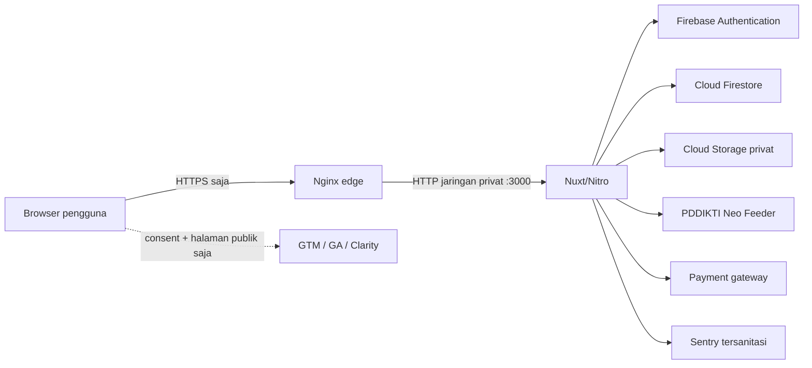
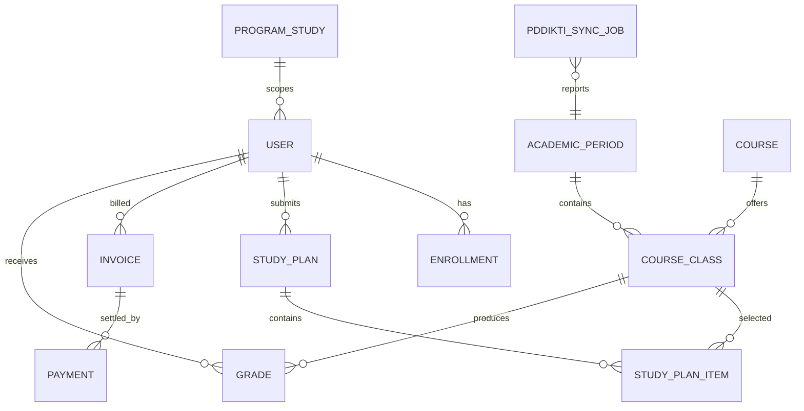

# Arsitektur dan model data

## Sasaran dan batas sistem

Arsitektur ini ditujukan untuk kapasitas awal sekitar 2.000 mahasiswa beserta dosen, staf, calon mahasiswa, dan wali. Nuxt 3 dengan Vue 3 dan Bootstrap menyediakan SSR serta antarmuka responsif; Webpack adalah builder yang dikunci di konfigurasi Nuxt. Nitro menyediakan API server-side. Firebase Authentication, Cloud Firestore, dan Cloud Storage menjadi layanan identitas dan data. Nginx adalah entry point produksi.

Integrasi eksternal—Neo Feeder, payment gateway, email, Sentry, dan analytics—tidak boleh dipanggil langsung dari komponen Vue untuk operasi yang membutuhkan secret atau hak istimewa. Semua masuk melalui service layer server. jQuery, Select2/Choices, dan Quill hanya boleh hidup di wrapper komponen Vue yang memasang dan membersihkan instance pada lifecycle yang tepat.



Nginx dan Nitro tidak memakai shared response cache untuk data dinamis. Hanya aset content-hashed `/_nuxt/**` yang public/immutable. File privat tidak pernah dipetakan sebagai direktori statis; API memverifikasi role, scope, kepemilikan, MIME, ukuran, dan metadata sebelum membuat URL berumur pendek.

## Lapisan aplikasi

1. **Presentation** — page, layout, dan komponen Vue. UI menyembunyikan aksi yang tidak relevan, tetapi bukan batas keamanan.
2. **Application/API** — handler Nitro memvalidasi skema, autentikasi, permission, scope, idempotency key, lalu memanggil service.
3. **Domain service** — aturan KRS, kapasitas kelas, tagihan, pembayaran, yudisium, dan status sinkronisasi. Operasi penting memakai transaction/batch.
4. **Adapter** — repository Firestore, Storage, Neo Feeder, payment gateway, email, serta telemetry. Adapter mengubah error vendor menjadi kode domain yang stabil.
5. **Operational edge** — Nginx, container, TLS, rate limiting, health/readiness, log metadata, backup, dan monitoring.

Semua request memiliki `X-Request-ID` dari Nginx. ID tersebut boleh masuk log teknis dan audit untuk korelasi, tetapi query string, bearer token, cookie, body, dan isi dokumen tidak boleh masuk access log.

## Identitas dan otorisasi

Firebase Authentication menerbitkan ID token. Server menukarnya dengan session cookie `HttpOnly`, `Secure`, dan `SameSite=Strict`, atau memverifikasi bearer token untuk klien tepercaya. Custom claims hanya berisi identifier role dan scope yang ringkas; profil lengkap tetap di Firestore. Penonaktifan akun diikuti revocation token.

Keputusan akses adalah kombinasi:

```text
authenticated AND account.active AND permission(role) AND scope(unit/program/cohort/owner)
```

Role ganda saat ini menghasilkan union permission, kemudian selalu dipersempit oleh scope. Operasi berisiko tinggi (role admin, pembayaran, penerbitan dokumen, dan sinkron PDDIKTI) memerlukan audit, pemeriksaan server, dan autentikasi baru bila kebijakan kampus menetapkannya. Lihat [matriks role](./role-matrix.md).

## Model data Firestore

Nama koleksi adalah kontrak konseptual; perubahan nama wajib disertai migration plan dan pembaruan Rules/indeks. Dokumen memakai ID stabil, `createdAt`, `createdBy`, `updatedAt`, `updatedBy`, dan `version` bila ada optimistic concurrency. Timestamp disimpan UTC. Label tampilan tidak dipakai sebagai foreign key.

| Koleksi | Isi utama | Partition/scope penting |
|---|---|---|
| `users` | profil, status, role, unit dan scope | UID Firebase; PII dibatasi |
| `units`, `programStudies` | struktur kampus dan program studi | identifier institusi stabil |
| `academicPeriods` | tahun/semester, kalender, deadline | `periodId`, status aktif |
| `courses`, `curricula` | mata kuliah, prasyarat, ekuivalensi | program studi dan versi kurikulum |
| `courseClasses` | kelas, jadwal, ruang, pengajar, kapasitas | periode + program studi |
| `enrollments`, `studyPlans` | status mahasiswa dan KRS/KPRS | mahasiswa + periode; field `version` |
| `attendanceSessions`, `attendanceRecords` | pertemuan, QR, presensi | kelas + sesi; QR tidak menyimpan biometrik |
| `teachingJournals`, `gradeBooks`, `grades` | realisasi, komponen, nilai | kelas; publikasi nilai eksplisit |
| `applicants`, `admissionWaves` | formulir PMB, verifikasi, hasil | gelombang + prodi; dokumen di Storage |
| `invoices`, `payments` | tagihan dan penerimaan | mahasiswa + periode; rupiah integer |
| `scholarships`, `studentActivities`, `violations` | kemahasiswaan | mahasiswa + periode/prodi |
| `learningMaterials`, `assignments`, `submissions` | LMS, tugas, feedback | kelas; file di Storage |
| `lecturerEvaluations`, `evaluationResponses` | instrumen dan respons anonim | periode + kelas; identitas dipisahkan |
| `graduationPeriods`, `graduationCandidates`, `issuedDocuments` | yudisium, wisuda, nomor dokumen | periode; nomor unik transaksional |
| `tracerSurveys`, `tracerResponses` | instrumen dan outcome alumni | cohort; consent dan retensi |
| `serviceTickets`, `notifications` | layanan tata usaha dan notifikasi | pemilik, unit penanggung jawab |
| `files` | metadata, owner, object path, MIME, checksum, versi | konten berada di Storage privat |
| `pddiktiMappings`, `pddiktiSyncJobs` | mapping identifier, antrean dan retry | periode + entity type + status |
| `idempotencyKeys` | hasil operasi eksternal/keuangan yang dapat diulang | hash key + actor + operation; TTL |
| `auditLogs` | kejadian bisnis append-only | waktu + actor + resource + outcome |
| `dashboardSnapshots` | agregat terkontrol untuk dashboard | periode + unit/prodi; tanpa data baris sensitif |

Jangan menaruh daftar yang tumbuh tanpa batas sebagai array dalam satu dokumen. Gunakan koleksi/subkoleksi untuk peserta kelas, respons, transaksi, presensi, dan log. Simpan duplikasi yang diperlukan untuk query hanya jika sumber kebenaran serta mekanisme rekonsiliasinya jelas.

### Relasi inti



## Invarian dan transaksi kritis

- **KRS:** transaction membaca status mahasiswa, cekal, batas SKS, kapasitas kelas, tabrakan jadwal, serta `version`; lalu menulis KRS dan perubahan kapasitas secara atomik. Persetujuan hanya oleh wali yang ditetapkan atau staf dalam scope.
- **Pembayaran:** unique `externalReference` dan idempotency key diperiksa dalam transaction yang sama dengan pembuatan `payments`, pembaruan `invoices.paidAmount/status`, serta audit. Callback selalu diverifikasi tanda tangannya.
- **Nomor dokumen:** nomor ijazah/SK/transkrip dialokasikan melalui counter atau reservation document atomik dan tidak didaur ulang diam-diam.
- **Konversi PMB:** applicant diterima dikonversi satu kali; mapping applicant–student dan NIM unik ditulis bersama atau dikompensasi dengan state machine.
- **Sinkronisasi PDDIKTI:** job memiliki state `QUEUED → PROCESSING → SUCCEEDED/FAILED/DEAD_LETTER`, lease, `attempts`, `nextAttemptAt`, fingerprint payload, dan idempotency key. Retry tidak membuat entitas ganda.
- **Audit:** audit log keberhasilan/penolakan dibuat server-side. Pengguna biasa tidak dapat update/delete. Data before/after disaring agar tidak menyalin secret atau dokumen penuh.

## Indeks dan pola query

Setiap daftar wajib memakai pagination berbasis cursor, batas halaman, filter terindeks, dan urutan deterministik (`createdAt` lalu document ID). Contoh composite index yang biasanya diperlukan:

- `studyPlans`: `programStudyId ASC, periodId ASC, status ASC, submittedAt DESC`;
- `invoices`: `programStudyId ASC, status ASC, dueDate ASC`;
- `pddiktiSyncJobs`: `status ASC, nextAttemptAt ASC, createdAt ASC`;
- `auditLogs`: `resource.type ASC, resource.id ASC, occurredAt DESC`;
- `applicants`: `waveId ASC, programStudyId ASC, status ASC, submittedAt DESC`.

Indeks aktual berada di `firebase/firestore.indexes.json`. Uji query pada emulator dan dataset representatif; jangan menangani index error dengan membaca seluruh koleksi di memori.

## Konsistensi, privasi, dan retensi

Data operasional Firestore konsisten kuat untuk document read/query, tetapi integrasi eksternal tidak berada dalam transaction yang sama. Gunakan outbox/job, idempotency, rekonsiliasi, dan state eksplisit. Dashboard boleh eventual-consistent dan menampilkan `updatedAt`.

Kelas data minimal:

| Kelas | Contoh | Perlakuan |
|---|---|---|
| Publik | program studi, jadwal PMB publik | boleh di-cache sesuai kebijakan |
| Internal | kalender staf, agregat operasional | autentikasi + scope; tidak di analytics |
| Rahasia | identitas, nilai, KRS, dokumen | no-store, least privilege, audit akses/perubahan |
| Sangat rahasia | credential, token, private key, bukti bayar | secret manager/Storage privat; tidak pernah di log/telemetry |

Jadwal retensi disahkan oleh pemilik data dan pejabat privasi. TTL boleh dipakai untuk idempotency key, token sementara, dan notifikasi lama; audit keuangan/akademik serta dokumen resmi mengikuti kebijakan arsip dan hukum, bukan dihapus otomatis oleh developer.

## Skalabilitas dan kegagalan

Untuk 2.000 mahasiswa, satu instance awal dapat memadai bila query dibatasi dan pekerjaan berat berjalan sebagai job. Horizontal scaling aman hanya jika session/state tidak disimpan di memori proses dan worker memakai lease. Neo Feeder, email, ekspor, notifikasi massal, dan agregasi dashboard harus async, ber-rate-limit, dan dapat dilanjutkan setelah restart.

Ketika Firebase tidak siap, `/api/health` tetap 200 selama proses hidup sedangkan `/api/ready` menjadi 503. Load balancer harus mengeluarkan instance yang tidak ready tanpa melakukan restart loop hanya karena gangguan dependensi singkat.
