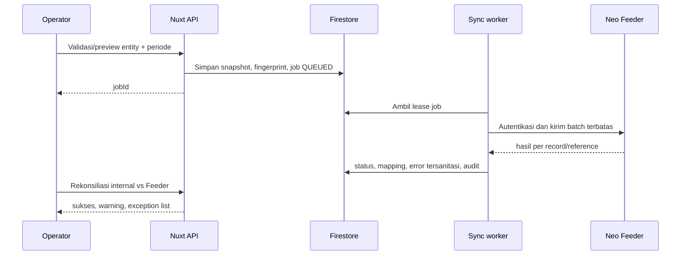

# Integrasi PDDIKTI Neo Feeder

## Batas dan prinsip

Neo Feeder diakses hanya oleh adapter server. URL, username, password, dan token tidak boleh masuk bundle browser. Karena kontrak dan referensi data Feeder dapat berbeda antar versi/periode, adapter harus mengunci versi yang disetujui operator PDDIKTI serta memiliki contract test terhadap staging/sandbox resmi kampus sebelum rilis.

Sumber kebenaran operasional tetap data internal kampus. Feeder adalah target pelaporan dan sumber referensi tertentu; perbedaan tidak ditimpa otomatis tanpa preview, validasi, dan keputusan operator.

## Konfigurasi

```dotenv
NEO_FEEDER_BASE_URL=https://feeder.internal.example
NEO_FEEDER_USERNAME=
NEO_FEEDER_PASSWORD=
NEO_FEEDER_TIMEOUT_MS=30000
NEO_FEEDER_MAX_ATTEMPTS=5
```

Tempatkan endpoint Feeder di jaringan privat/VPN dan allowlist egress bila memungkinkan. Gunakan TLS yang tervalidasi; jangan menonaktifkan certificate verification. Account integrasi harus khusus, least privilege, dirotasi, dan tidak digunakan login interaktif.

API platform saat ini menyediakan kontrak awal:

- `POST /api/pddikti/sync` — validasi scope dan antrekan job;
- `GET /api/pddikti/jobs` — daftar/history scoped;
- `POST /api/pddikti/jobs/:id/retry` — retry job gagal dengan permission.

Endpoint tidak menunggu keseluruhan sinkronisasi. Respons create mengembalikan job ID; worker memproses async.

## Alur data



## Model job dan idempotency

Simpan minimal `entityType`, `entityIds`, `periodId`, `status`, `attempts`, `maxAttempts`, `nextAttemptAt`, `leaseOwner`, `leaseExpiresAt`, `payloadFingerprint`, `createdBy`, timestamps, dan `lastError` tersanitasi. Status: `QUEUED`, `PROCESSING`, `SUCCEEDED`, `FAILED`, `DEAD_LETTER`.

Idempotency key dibentuk dari environment + version adapter + entity type + stable internal ID + periode + payload fingerprint. Simpan mapping stable internal ID ke Feeder ID. Sebelum insert, cek mapping dan lakukan read/reconcile bila hasil request sebelumnya tidak diketahui akibat timeout.

Retry hanya untuk error sementara (timeout, 429, 5xx, koneksi). Gunakan exponential backoff dengan jitter dan hormati rate limit. Error validasi/4xx menjadi exception yang harus diperbaiki; jangan retry cepat. Worker memakai lease sehingga crash dapat dipulihkan tanpa dua worker mengirim job sama.

## Dependency order

Urutan baseline, disesuaikan referensi API resmi yang berlaku:

1. referensi dan mapping program studi/periode;
2. dosen dan mahasiswa;
3. mata kuliah/kurikulum;
4. kelas dan pengajar;
5. peserta kelas/KRS;
6. nilai dan aktivitas mahasiswa;
7. kelulusan/yudisium serta data terkait.

Job dependent tidak boleh berjalan sebelum parent mapping sukses. Deletion/correction adalah workflow terpisah dengan approval; jangan menyamakan “tidak ada di internal” dengan instruksi hapus di Feeder.

## Validasi sebelum antre

- identifier wajib, format, panjang, dan referensi code table valid;
- periode pelaporan dan program studi sesuai scope/operator;
- relasi parent tersedia/mapped;
- tanggal kronologis dan zona waktu benar;
- nilai/SKS/status domain sesuai aturan periode;
- tidak ada duplikasi stable ID atau mapping konflik;
- payload berubah setelah approval memerlukan preview/approval baru.

Preview menampilkan field change tanpa mengekspos credential atau data sensitif yang tidak diperlukan. Export exception harus diotorisasi dan aman dari spreadsheet formula injection.

## Token dan logging

Cache token hanya di memory/secret store dengan expiry lebih pendek dari expiry server dan single-flight refresh agar worker tidak melakukan login serentak. Pada 401, invalidasi token satu kali dan autentikasi ulang; 401 berulang memicu circuit breaker serta alert.

Log yang boleh: request ID internal, job ID, entity type, stable ID ter-mask bila perlu, status HTTP, kode error, durasi, attempt, dan Feeder reference yang tidak rahasia. Jangan log URL query berisi token, header, credential, payload penuh, NIK, tanggal lahir, alamat, nilai rinci, atau response mentah. Audit bisnis terpisah mencatat siapa mengantre/retry/approve.

## Rekonsiliasi

Setelah batch:

1. tarik status/record target dengan batas/rate yang disetujui;
2. cocokkan stable mapping, count, checksum field penting, dan periode;
3. klasifikasikan `MATCH`, `INTERNAL_NEWER`, `FEEDER_NEWER`, `MISSING_INTERNAL`, `MISSING_FEEDER`, `CONFLICT`;
4. operator menyelesaikan exception; setiap correction memiliki alasan dan audit;
5. dashboard menampilkan completeness, last success, queued, failed, dan dead letter dengan timestamp.

Jangan menyatakan job sukses hanya karena HTTP 200 tingkat request; evaluasi hasil setiap record sesuai kontrak Feeder.

## Pengujian penerimaan

- [ ] Credential/token tidak pernah terlihat di browser, log, error response, atau Sentry.
- [ ] Contract test menangkap perubahan schema/field/error Feeder.
- [ ] Duplicate submission, timeout setelah commit, 429, 5xx, invalid token, partial batch, malformed record, dan dependency missing diuji.
- [ ] Dua worker tidak memproses lease yang sama; expired lease dapat direcovery.
- [ ] Retry tidak menggandakan entitas dan dead-letter dapat diperbaiki lalu di-requeue dengan permission.
- [ ] Cross-program operator mendapat 403 dan list job difilter server-side.
- [ ] Reconciliation terhadap dataset uji membuktikan record count dan mapping sama.
- [ ] Runbook penghentian sinkron, rotasi credential, serta pemulihan backlog telah dilatih operator.
